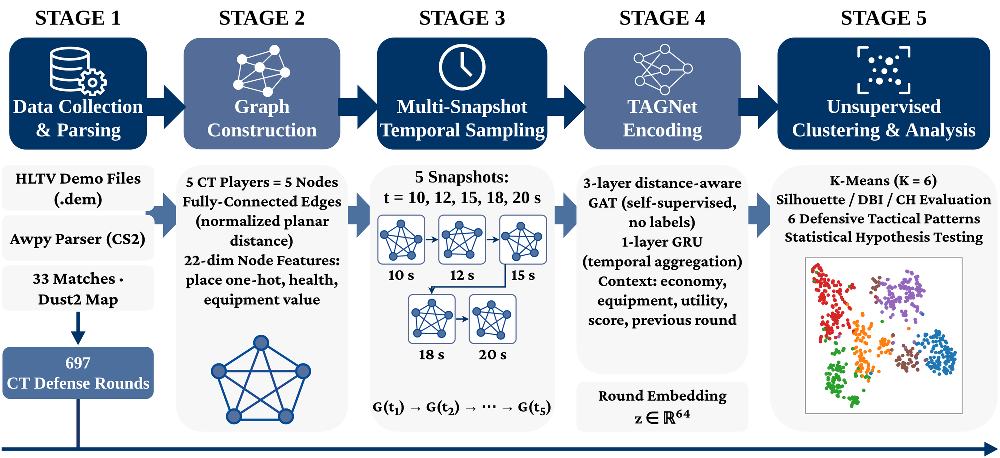
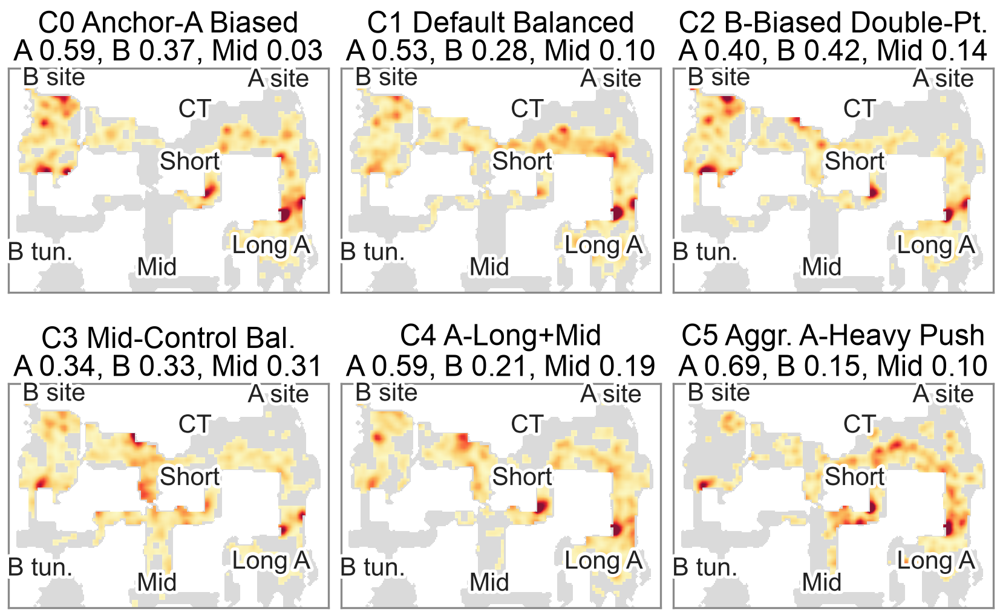
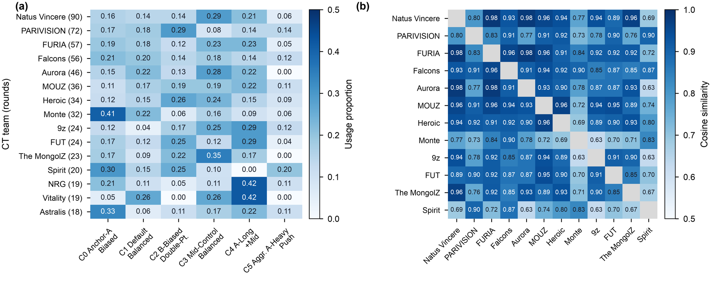
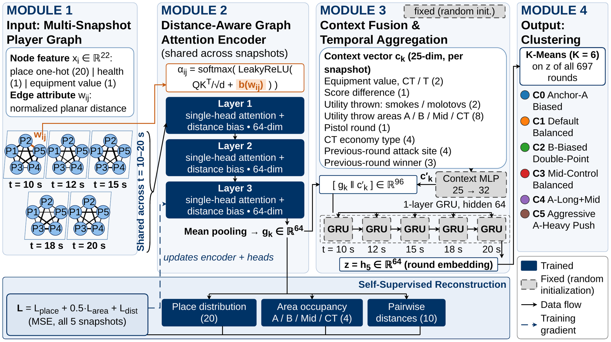
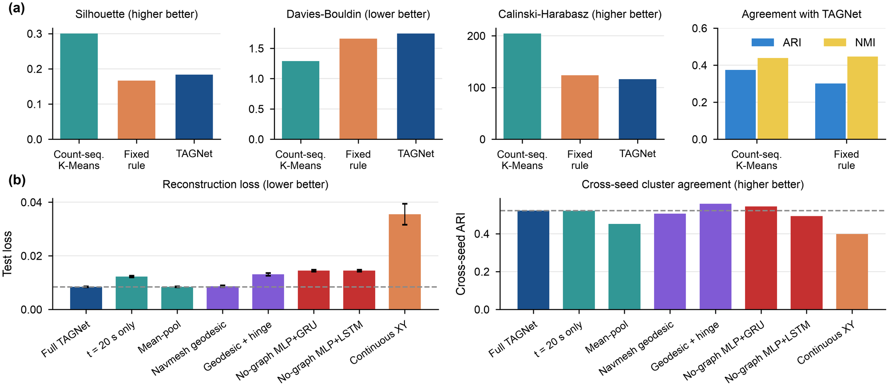

<h1 align="center">TAGNet</h1>

<p align="center"><b>Temporal Attention Graph Network for Defensive Tactical Pattern Recognition in Professional Counter-Strike 2</b></p>

<p align="center">
  <a href="#citation"></a>
  <a href="LICENSE"></a>
  
  
</p>

<p align="center"><b>English</b> | <a href="README_zh-CN.md">简体中文</a></p>

<p align="center">
  
</p>

Code, processed data and reference outputs for the paper

> X. Zhang, R. Zhang, G. Chen, X. Cao, C. Yue, and C. Yuan, "TAGNet: Temporal Attention Graph Network for Defensive Tactical Pattern Recognition in Professional Counter-Strike 2," *IEEE Transactions on Games*, 2026 (accepted).

TAGNet represents the five CT players of a professional CS2 round on Dust2 as a fully connected player graph at five moments after the freeze time ends (10, 12, 15, 18 and 20 s). A distance-aware graph attention encoder, trained without labels, embeds each snapshot; the snapshot sequence and a per-snapshot match-context vector are aggregated in temporal order by a GRU into a 64-dimensional round embedding, and K-Means on these embeddings yields six defensive patterns (C0–C5). The patterns are then related to economy, score state and previous-round information, and summarised per team.

## Highlights

- **Distance-aware graph attention.** The distance between two players enters every attention score through a learned bias, so the encoder learns how strongly spatial proximity shapes their interaction.
- **No tactical labels.** The encoder is trained by reconstructing, at every snapshot, where the five players stand, how they occupy the A / B / Mid / CT areas, and how far apart they are.
- **Six interpretable defensive patterns** discovered on 697 CT rounds from 33 top-tier matches, from anchor defence (C0) to aggressive forward pressure (C5).
- **Context matters.** CT economy type is the strongest predictor of the chosen pattern (χ² = 96.25, Holm-corrected p < 0.001), and aggressive forward pressure (C5) is used significantly more often when trailing (p < 0.01).
- **Fully reproducible.** Processed data, trained checkpoints and the outputs of every run in the paper are included; `./reproduce.sh` rebuilds the main results in about two minutes on a laptop CPU.

## Six defensive patterns

<p align="center">
  
</p>

| Cluster | Pattern | Rounds | A / B share at 15 s | CT round win rate |
|---|---|---:|:---:|---:|
| C0 | Anchor-A Biased | 124 | 0.59 / 0.37 | 57.3% |
| C1 | Default Balanced | 109 | 0.53 / 0.28 | 49.5% |
| C2 | B-Biased Double-Point | 115 | 0.40 / 0.42 | 59.1% |
| C3 | Mid-Control Balanced | 151 | 0.34 / 0.33 | 44.4% |
| C4 | A-Long+Mid | 136 | 0.59 / 0.21 | 52.2% |
| C5 | Aggressive A-Heavy Push | 62 | 0.69 / 0.15 | 24.2% |

<table>
  <tr>
    <td width="50%"></td>
    <td width="50%"></td>
  </tr>
  <tr>
    <td align="center"><em>t-SNE of the 697 round embeddings (Fig. 5)</em></td>
    <td align="center"><em>How each pattern evolves between 10 and 20 s (Fig. 6)</em></td>
  </tr>
</table>

<p align="center">
  
  <br><em>Team tactical fingerprints and style similarity (Fig. 7)</em>
</p>

All figures are taken from the paper and can be regenerated with the scripts below.

---

## Contents

```
TAGNet-CS2/
├── scripts/                     Main pipeline
│   ├── parse_demos.py           .dem  -> per-match Awpy tables (Parquet)
│   ├── prepare_data.py          per-match tables -> model-ready dataset
│   ├── train_tagnet.py          model definition and training
│   ├── analyze_results.py       K selection, clustering, statistics, t-SNE
│   ├── visualize_results.py     figures from the analysis outputs
│   ├── extract_attention.py     attention matrices of the trained encoder
│   ├── team_fingerprints_by_name.py   team fingerprints / similarity (Fig. 7)
│   ├── ablation_table.py        ablation table (Table VI)
│   ├── make_paper_figures.py    published versions of Figs. 3 and 5-11
│   ├── search_architecture.py   architecture search over GAT/GRU sizes
│   └── compare_clusterers.py    K-Means vs. other clusterers on the embeddings
├── supplementary/               Robustness checks of Section IV-K
│   ├── train_variants.py        temporal / graph / distance / position variants
│   ├── run_supplement_suite.py  all variants x 5 seeds
│   ├── summarize_supplement.py  Table VIII
│   ├── rule_baseline.py         rule-based positional baseline (Table VII)
│   └── holm_correction.py       Holm correction (Table IX)
├── data/                        Processed data (see data/README.md)
├── results/                     Outputs of the runs reported in the paper
├── docs/figures/                Figures shown in this README
├── reproduce.sh                 one-command check of the main results
├── README_zh-CN.md              Chinese version of this file
├── requirements.txt
├── CITATION.cff
└── LICENSE
```

## Installation

```bash
python -m venv .venv
source .venv/bin/activate
pip install -r requirements.txt
```

The release was verified with Python 3.13 on CPU (versions pinned in `requirements.txt`); the original experiments ran on Python 3.11 with a CUDA GPU. A GPU is not required: training one model takes about 15 s on a laptop CPU. `awpy` is only needed for `parse_demos.py`, and it must be version 2.0.2 (Awpy 3 changed its API).

## Data

`data/processed/` contains the dataset used in the paper, in Parquet and CSV, so all experiments can be rerun without the raw demos: 697 CT-side rounds from 33 professional Dust2 matches (HLTV, 2024–2025), split by match into 486 / 95 / 116 train / validation / test rounds. `data/match_list.csv` lists the matches and `data/README.md` documents every file and column.

The raw demos are not redistributed; they are publicly available on HLTV. To build a dataset from demos with the same procedure, run:

```bash
python scripts/parse_demos.py --demo-dir path/to/demos --output-root data/parsed
python scripts/prepare_data.py --dataset-root data/parsed \
    --output-root data/processed/dust2_ct_5snap --snapshot-seconds 10 12 15 18 20
```

`prepare_data.py` takes the team names from the folder name, so each parsed folder should be named like the `match_id` in `match_list.csv` (use `--name-map` in `parse_demos.py`).

## Quick start

To rebuild the main tables and figures from the released checkpoint and compare the key numbers with the paper (about two minutes on a laptop CPU):

```bash
./reproduce.sh
```

Outputs are written to `runs/reproduce/`, and the script ends by printing the selected K, the cluster sizes and the economy-type chi-square next to the values reported in the paper.

To train the model from scratch and run the same analysis:

```bash
# 1. Train TAGNet (3 graph-attention layers, 1-layer GRU, seed 42)
python scripts/train_tagnet.py --gat-layers 3 --k-list 3 4 5 6 7 8 9 10 \
    --run-root runs --run-name tagnet

# 2. K selection (K = 2..15), K-Means with the selected K, statistics, t-SNE
python scripts/analyze_results.py --run-dir runs/tagnet

# 3. Figures, attention matrices and team-level summaries
python scripts/visualize_results.py --analysis-dir runs/tagnet_analysis
python scripts/extract_attention.py --run-dir runs/tagnet --analysis-dir runs/tagnet_analysis
python scripts/team_fingerprints_by_name.py --analysis-dir runs/tagnet_analysis
```

Without arguments, the analysis scripts read the reference run in `results/tagnet_main/run` and write into `results/tagnet_main/run_analysis`, so steps 2–3 can be run directly on the checkpoint used in the paper.

## Reproducing each table and figure

| Paper | Command | Output |
|---|---|---|
| Table I | `prepare_data.py` | `data/processed/dust2_ct_5snap/summary.json`, `splits.json` |
| Table III, Fig. 3 (TAGNet) | `train_tagnet.py --gat-layers 3` | `run_summary.json`, `training_history.csv` |
| Table III, Fig. 3 (baseline) | `train_tagnet.py --gat-layers 2 --legacy-baseline-encoder --data-dir data/processed/dust2_ct_3snap` | same files; see note 1 below |
| Table IV | `analyze_results.py` | `k_selection_metrics.csv`, `figures/fig_k_selection.*` |
| Fig. 4 | `make_paper_figures.py` (base map from `build_map_mask.py`) | `paper_figures/fig4_cluster_heatmaps.*` |
| Fig. 5 | `analyze_results.py`, `visualize_results.py` | `tsne_coordinates.parquet`, `figures/fig_tsne_clusters.*` |
| Fig. 6 | `analyze_results.py`, `visualize_results.py` | `cluster_profiles.csv`, `figures/fig_cluster_area_over_time.*` |
| Fig. 7(a) | `team_fingerprints_by_name.py` | `team_style_fingerprints_by_name.csv` |
| Fig. 7(b) | `team_fingerprints_by_name.py` | `team_style_similarity_by_name_pairs.csv` (similarity = 1 − cosine distance) |
| Table V, Fig. 8(a) | `analyze_results.py` | `context_trigger_tests.csv` |
| Fig. 9 | `analyze_results.py` | `h2_score_state_paired_ttest.csv`, `h2_score_state_team_pairs.csv` |
| Table VI, Fig. 10 | `train_tagnet.py` with `--no-context`, `--no-graph`, `--single-snapshot 15`; then `ablation_table.py` | `results/ablations/ablation_table.csv` |
| Table VII, Fig. 11(a) | `supplementary/rule_baseline.py` | `baseline_metrics.json`, `final_area_config_counts.csv` |
| Table VIII, Fig. 11(b) | `supplementary/run_supplement_suite.py`, then `summarize_supplement.py` | `original_protocol_summary.csv` |
| Table IX, Fig. 8(b), Holm column of Table V | `supplementary/holm_correction.py` | `holm_summary.csv` and the corrected test tables |

`scripts/make_paper_figures.py` draws the published versions of Figs. 3–11 from the files in `results/` (vector PDF and 600 dpi PNG, sized for the IEEE layout) into `results/paper_figures/`. Figs. 1 and 2 are diagrams. The grey base map of Fig. 4 is the Dust2 walkable area estimated from player positions in parsed demos (`data/map/dust2_walkable_mask.npz`, built by `scripts/build_map_mask.py`), so no game asset is redistributed.

Full commands for the supplementary experiments:

```bash
python supplementary/run_supplement_suite.py              # runs/supplementary/<variant>_seed<n>
python supplementary/summarize_supplement.py --run-root runs/supplementary \
    --output-dir runs/supplementary_summary
python supplementary/rule_baseline.py --data-dir data/processed/dust2_ct_5snap \
    --tagnet-run-dir results/tagnet_main/run --output-dir runs/rule_baseline
python supplementary/holm_correction.py --analysis-dir results/tagnet_main/run_analysis \
    --output-dir runs/holm
```

## Method

<p align="center">
  
  <br><em>TAGNet architecture (Fig. 2)</em>
</p>

**Input.** For each round and snapshot, five CT player nodes with 22 features: a one-hot of 20 named Dust2 places, health / 100, and log(1 + equipment value) min-max scaled with training-split bounds. Edges connect all player pairs; the edge attribute is the planar (X, Y) Euclidean distance divided by the largest pairwise distance in the training split (4215.87 units).

**Snapshot encoder** (`SnapshotEncoder`, 3 layers, width 64). Each layer is single-head scaled dot-product attention over the five players, `softmax(LeakyReLU(QKᵀ/√d + b(w_ij)))V`, where `b(·)` is a small MLP (1 → 64 → 1, GELU) of the normalized distance `w_ij`, followed by LayerNorm, and then a residual feed-forward block with LayerNorm. Mean pooling over players gives the snapshot embedding `g_k ∈ R⁶⁴`.

**Context and temporal aggregation.** A 25-dimensional context vector is built for every snapshot: CT and T equipment value (2), score difference (1), number of CT smokes and molotovs thrown so far (2), share of those smokes and molotovs thrown from A / B / Mid / CT (8), pistol-round flag (1), CT economy type (4), previous-round attack site (4) and previous-round winner (3). A two-layer MLP maps it to 32 dimensions; `[g_k ‖ c'_k]` (96-d) is fed to a one-layer GRU with hidden size 64, and its final hidden state is the round embedding `z`.

**Objective.** Three heads decode each snapshot embedding `g_k`: the distribution of the five players over the 20 places (softmax), over the four macro areas A / B / Mid / CT (softmax), and the 10 normalized pairwise distances (sigmoid). Each is an MSE loss averaged over the five snapshots; the total loss is `1.0·L_place + 0.5·L_area + 1.0·L_dist`. Because the heads read `g_k` directly, this loss does not depend on the context MLP or the GRU. These two modules keep their seeded initialization and act as a fixed, order-aware recurrent aggregator of the learned snapshot embeddings and the context, in the spirit of the untrained reservoirs of echo state networks; all representation learning takes place in the graph attention encoder. The supplementary variants use the same setup.

**Training.** AdamW (learning rate 1e-3, weight decay 1e-4), batch size 64 in fixed order, gradient clipping at 5.0, at most 40 epochs with early stopping on validation loss (patience 10), `torch.manual_seed(42)`.

**Clustering and K selection.** `analyze_results.py` runs scikit-learn K-Means (`n_init=20`, `random_state=42`) on all 697 embeddings for K = 2…15, ranks every K by silhouette (descending), Davies–Bouldin (ascending) and Calinski–Harabasz (descending) using dense ranks over all 14 candidates, and selects the K with the lowest mean rank (K = 6, mean rank 4.33). Table IV in the paper lists the rows K ≤ 8 of this ranking. `train_tagnet.py` also runs a simple K-Means on the embeddings at the end of training and stores, for each K in `--k-list`, the assignments and silhouette (`k_metrics.json`, `best_k_by_silhouette`); these training-stage partitions are only used for the ablation table.

**Cluster names.** `analyze_results.py` drafts a name for each cluster with a fixed threshold rule on the cluster's 15 s area shares (`infer_tactical_name`); the output is `cluster_naming_heuristic.csv`. The score in that file is a constant attached to each rule, not a human rating.

## Reference results and verification

`results/` contains the original outputs (GPU) of every run reported in the paper:

| Folder | Run |
|---|---|
| `tagnet_main/run` | TAGNet, seed 42 (main results) |
| `tagnet_main/run_analysis` | analysis, figures and attention matrices of that run |
| `tagnet_main/run_clusterer_compare` | K-Means vs. other clusterers |
| `baseline_2layer_3snap/run` | 2-layer baseline of Table III |
| `ablations/{no_context,no_graph,single_snapshot_15s}` | ablations of Table VI |
| `architecture_search` | architecture search summary |
| `supplementary/runs/<variant>_seed<n>` | 8 supplementary variants × 5 seeds |
| `supplementary/{summary,rule_baseline,holm}` | Tables VII–IX |

<p align="center">
  
  <br><em>Test loss and cross-seed agreement of the supplementary checks (Fig. 11)</em>
</p>

All analysis outputs in `results/` were regenerated with the code in this repository from the stored checkpoints and embeddings, and agree with the outputs used for the paper: all statistical and clustering tables to within 1e-11, and the attention matrices (recomputed on CPU from the GPU checkpoint) to within 1e-6. The exception is the t-SNE coordinates, which depend on the scikit-learn version. The layout shown in Fig. 5 is kept in `tagnet_main/run_analysis/tsne_coordinates_paper_fig6.parquet`.

Retraining from scratch on CPU gives:

| Run | Test loss, paper run (GPU) | Test loss, retrained (CPU) |
|---|---:|---:|
| TAGNet | 0.008583 | 0.008583 |
| 2-layer baseline (`--legacy-baseline-encoder`, 3 snapshots) | 0.009426 | 0.009426 |
| w/o graph structure | 0.014291 | 0.014291 |
| w/o context | 0.008551 | 0.008554 |
| w/o temporal module (15 s only) | 0.009026 | 0.009086 |

Small differences between CPU and GPU runs are expected from floating-point non-determinism and can change the early-stopping epoch.

The losses are reproduced, but the clustering is sensitive to these small differences. On the CPU retrain of TAGNet (seed 42), the round embeddings differ from the GPU run by at most 0.075. The K = 6 partition then agrees with the one used in the paper at ARI = 0.68 (cluster sizes 82/102/105/124/133/151 instead of 62/109/115/124/136/151), and the mean-rank rule selects K = 2. This is in line with the cross-seed ARI of about 0.52 reported in Section IV-K. To reproduce the clusters, figures and statistics of the paper exactly, run the analysis on the released checkpoint and embeddings in `results/tagnet_main/run`, as the default arguments do. The K-Means partition also depends on the row order of the embedding file; keep the order written by `train_tagnet.py`.

## Notes and known limitations

1. **Baseline of Table III.** The 2-layer baseline comes from an earlier version of the pipeline. It differs from TAGNet in three ways: two attention layers instead of three, one feed-forward block and LayerNorm shared by both layers instead of one per layer, and three snapshots (10/15/20 s, `data/processed/dust2_ct_3snap`) instead of five. `--legacy-baseline-encoder` reproduces it exactly.
2. **Ablation table.** Each variant in Table VI is evaluated on its training-stage partition at its own best K (`best_k_by_silhouette`; K = 8 for the full model), not on the K = 6 partition used for the tactical analysis. `ablation_table.py` reproduces the table; for the full model the paper's DBI and CH values (1.7094, 104.67) are the scikit-learn K = 8 values from `k_selection_metrics.csv`, while `ablation_table.py` gives 1.7097 and 104.65 on the training-stage partition.
3. **Navmesh geodesic variants.** The prepared dataset with navmesh geodesic edge distances, and the code that computed those distances, are not included. The trained runs and their results are in `results/supplementary/runs/nav_geodesic*`; `run_supplement_suite.py` skips these two variants when the dataset is missing.
4. **Demo parsing.** `parse_demos.py` generalizes the export step of the original single-demo notebook to a batch script. With Awpy 2.0.2 it produces exactly the tick columns of the original parsed matches, and `prepare_data.py` reproduces the released node, edge and context tables for the three matches whose original parsed folders were available for checking.
5. Checkpoints store the training arguments, including absolute paths on the machine used for the experiments.

## Citation

```bibtex
@article{zhang2026tagnet,
  author  = {Zhang, Xiang and Zhang, RongQi and Chen, Guancheng and Cao, Xinlei and Yue, ChaoFan and Yuan, Chunhong},
  title   = {{TAGNet}: Temporal Attention Graph Network for Defensive Tactical Pattern Recognition in Professional {Counter-Strike} 2},
  journal = {IEEE Transactions on Games},
  year    = {2026},
  note    = {Accepted for publication}
}
```

## License

Code is released under the MIT License (see `LICENSE`). The processed data are derived from publicly available tournament demos and are provided for research use.

## Acknowledgements

Demo parsing uses [Awpy](https://github.com/pnxenopoulos/awpy) (P. Xenopoulos, W. R. Freeman, and C. Silva, "Analyzing the Differences between Professional and Amateur Esports through Win Probability," WWW 2022).
