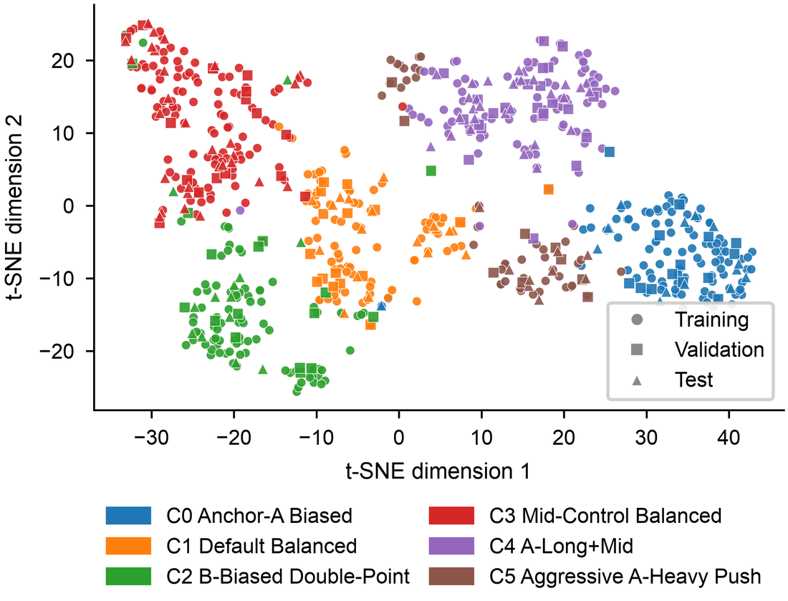
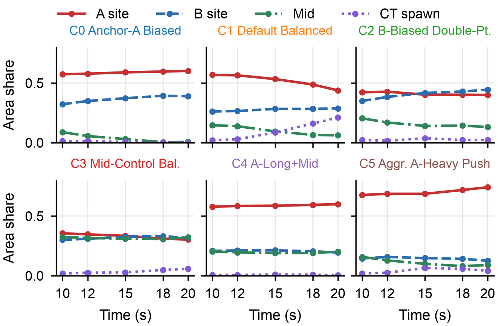

<h1 align="center">TAGNet</h1>

<p align="center"><b>面向职业《反恐精英 2》防守战术模式识别的时序注意力图网络</b></p>

<p align="center">
  <a href="https://ieeexplore.ieee.org/document/11744413"></a>
  <a href="https://doi.org/10.1109/TG.2026.3745970"></a>
  <a href="LICENSE"></a>
  
  
</p>

<p align="center"><a href="README.md">English</a> | <b>简体中文</b></p>

<p align="center">
  
</p>

本仓库提供以下论文的代码、处理后的数据和参考输出：

> X. Zhang, R. Zhang, G. Chen, X. Cao, C. Yue, and C. Yuan, "TAGNet: Temporal Attention Graph Network for Defensive Tactical Pattern Recognition in Professional Counter-Strike 2," *IEEE Transactions on Games*, early access, 2026, doi: [10.1109/TG.2026.3745970](https://doi.org/10.1109/TG.2026.3745970)。

TAGNet 把职业 CS2 比赛中 Dust2 地图上每个回合的 5 名 CT 选手，在冻结时间结束后的 5 个时刻（10、12、15、18、20 秒）各表示成一张全连接的选手图。无标签训练的距离感知图注意力编码器对每个快照编码；快照序列和每个快照的比赛情境向量按时间顺序由 GRU 聚合成 64 维的回合向量；对回合向量做 K-Means 聚类，得到 6 类防守模式（C0–C5）。之后再分析这些模式和经济、比分状态、上一回合信息之间的关系，并按队伍汇总。

## 亮点

- **距离感知的图注意力**：两名选手之间的距离通过一个可学习的偏置进入每一个注意力打分，编码器自己学习空间距离对选手之间协同的影响有多大。
- **不需要战术标注**：编码器通过重建每个快照的三类信息来训练：5 名选手站在哪里、在 A / B / 中路 / CT 各区如何分布、彼此相距多远。
- **6 类可解释的防守模式**：在 33 场顶级比赛的 697 个 CT 回合中自动发现，从锚点防守（C0）到激进前压（C5）。
- **比赛情境有显著影响**：CT 方经济类型是选择防守模式最强的预测因素（χ² = 96.25，Holm 校正后 p < 0.001）；落后时显著更多地采用激进前压（C5，p < 0.01）。
- **完全可复现**：仓库包含处理后的数据、训练好的模型权重和论文中每次实验的输出；运行 `./reproduce.sh`，在笔记本 CPU 上约两分钟即可重建主要结果。

## 六类防守模式

<p align="center">
  
</p>

| 簇 | 模式 | 回合数 | 15 秒时 A / B 占比 | CT 回合胜率 |
|---|---|---:|:---:|---:|
| C0 | Anchor-A Biased（A 点锚定） | 124 | 0.59 / 0.37 | 57.3% |
| C1 | Default Balanced（默认均衡） | 109 | 0.53 / 0.28 | 49.5% |
| C2 | B-Biased Double-Point（双点偏 B） | 115 | 0.40 / 0.42 | 59.1% |
| C3 | Mid-Control Balanced（中路控制均衡） | 151 | 0.34 / 0.33 | 44.4% |
| C4 | A-Long+Mid（A 大道兼顾中路） | 136 | 0.59 / 0.21 | 52.2% |
| C5 | Aggressive A-Heavy Push（A 点重兵前压） | 62 | 0.69 / 0.15 | 24.2% |

<table>
  <tr>
    <td width="50%"></td>
    <td width="50%"></td>
  </tr>
  <tr>
    <td align="center"><em>697 个回合向量的 t-SNE（图 4）</em></td>
    <td align="center"><em>各类模式在 10–20 秒之间的演变（图 5）</em></td>
  </tr>
</table>

<p align="center">
  
  <br><em>队伍战术指纹与风格相似度（图 6）</em>
</p>

以上图片均来自论文，可以用下文的脚本重新生成。

---

## 目录结构

```
TAGNet-CS2/
├── scripts/                     主流程
│   ├── parse_demos.py           .dem → 每场比赛的 Awpy 数据表（Parquet）
│   ├── prepare_data.py          每场比赛的数据表 → 模型可用的数据集
│   ├── train_tagnet.py          模型定义与训练
│   ├── analyze_results.py       选 K、聚类、统计检验、t-SNE
│   ├── visualize_results.py     根据分析结果画图
│   ├── extract_attention.py     提取训练好的编码器的注意力矩阵
│   ├── team_fingerprints_by_name.py   队伍战术指纹与相似度（图 6）
│   ├── ablation_table.py        消融实验表（表 VI）
│   ├── make_paper_figures.py    绘制论文中图 3–9 的正式版本
│   ├── search_architecture.py   GAT/GRU 规模的结构搜索
│   └── compare_clusterers.py    在回合向量上比较 K-Means 和其他聚类方法
├── supplementary/               IV-K 节的稳健性检验
│   ├── train_variants.py        时序、图结构、距离、位置编码等变体
│   ├── run_supplement_suite.py  所有变体 × 5 个随机种子
│   ├── summarize_supplement.py  表 VIII
│   ├── rule_baseline.py         规则位置基线（表 VII）
│   └── holm_correction.py       Holm 多重比较校正（表 IX）
├── data/                        处理后的数据（见 data/README.md）
├── results/                     论文中所有实验的输出
├── docs/figures/                README 中展示的图片
├── reproduce.sh                 一条命令核对主要结果
├── README_zh-CN.md              本文件（中文说明）
├── requirements.txt
├── CITATION.cff
└── LICENSE
```

## 安装

```bash
python -m venv .venv
source .venv/bin/activate
pip install -r requirements.txt
```

- 本仓库在 Python 3.13、CPU 环境下验证过，各依赖的版本已固定在 `requirements.txt` 里。原始实验是在 Python 3.11 和 CUDA GPU 上跑的。
- 不需要 GPU：在笔记本电脑的 CPU 上训练一个模型大约 15 秒。
- `awpy` 只有 `parse_demos.py` 会用到，版本必须是 2.0.2（Awpy 3 改了接口）。

## 数据

`data/processed/` 里是论文使用的数据集，提供 Parquet 和 CSV 两种格式，不需要原始 demo 就能重跑全部实验：
- 33 场职业 Dust2 比赛（HLTV，2024–2025）中的 697 个 CT 防守回合。
- 按比赛划分为训练、验证、测试三组，分别是 486、95、116 个回合。
- `data/match_list.csv` 列出了所有比赛；`data/README.md` 说明了每个文件和每一列的含义。

原始 demo 不在仓库中重新分发，它们在 HLTV 上可以公开下载。如果想用相同的流程从 demo 构建数据集，运行：

```bash
python scripts/parse_demos.py --demo-dir path/to/demos --output-root data/parsed
python scripts/prepare_data.py --dataset-root data/parsed \
    --output-root data/processed/dust2_ct_5snap --snapshot-seconds 10 12 15 18 20
```

`prepare_data.py` 会从文件夹名里读取两支队伍的名字，所以解析出来的每个文件夹，都要按 `match_list.csv` 里的 `match_id` 命名（可以用 `parse_demos.py` 的 `--name-map` 参数指定）。

## 快速开始

用发布的模型权重重建论文的主要表格和图，并把关键数字和论文对照（笔记本 CPU 上约两分钟）：

```bash
./reproduce.sh
```

输出写在 `runs/reproduce/` 里。脚本最后会打印选出的 K、各簇大小和经济类型的卡方值，并列出论文中的对应数值。

如果想从头训练模型并做同样的分析：

```bash
# 1. 训练 TAGNet（3 层图注意力、1 层 GRU，随机种子 42）
python scripts/train_tagnet.py --gat-layers 3 --k-list 3 4 5 6 7 8 9 10 \
    --run-root runs --run-name tagnet

# 2. 选 K（K = 2..15），用选出的 K 做 K-Means，做统计检验和 t-SNE
python scripts/analyze_results.py --run-dir runs/tagnet

# 3. 画图、提取注意力矩阵、汇总队伍层面的结果
python scripts/visualize_results.py --analysis-dir runs/tagnet_analysis
python scripts/extract_attention.py --run-dir runs/tagnet --analysis-dir runs/tagnet_analysis
python scripts/team_fingerprints_by_name.py --analysis-dir runs/tagnet_analysis
```

如果不带参数，分析脚本会读取 `results/tagnet_main/run` 里的参考结果，并把输出写进 `results/tagnet_main/run_analysis`。所以第 2、3 步可以直接在论文用的那个权重上运行。

## 复现论文中的每一张表和图

| 论文 | 命令 | 输出 |
|---|---|---|
| 表 I | `prepare_data.py` | `data/processed/dust2_ct_5snap/summary.json`、`splits.json` |
| 表 III（TAGNet） | `train_tagnet.py --gat-layers 3` | `run_summary.json`、`training_history.csv` |
| 表 III（基线） | `train_tagnet.py --gat-layers 2 --legacy-baseline-encoder --data-dir data/processed/dust2_ct_3snap` | 同上；见下文"说明"第 1 条 |
| 表 IV | `analyze_results.py` | `k_selection_metrics.csv`、`figures/fig_k_selection.*` |
| 图 3 | `make_paper_figures.py`（底图由 `build_map_mask.py` 生成） | `paper_figures/fig3_cluster_heatmaps.*` |
| 图 4 | `analyze_results.py`、`visualize_results.py` | `tsne_coordinates.parquet`、`figures/fig_tsne_clusters.*` |
| 图 5 | `analyze_results.py`、`visualize_results.py` | `cluster_profiles.csv`、`figures/fig_cluster_area_over_time.*` |
| 图 6(a) | `team_fingerprints_by_name.py` | `team_style_fingerprints_by_name.csv` |
| 图 6(b) | `team_fingerprints_by_name.py` | `team_style_similarity_by_name_pairs.csv`（相似度 = 1 − 余弦距离） |
| 表 V、图 7(a) | `analyze_results.py` | `context_trigger_tests.csv` |
| 图 8 | `analyze_results.py` | `h2_score_state_paired_ttest.csv`、`h2_score_state_team_pairs.csv` |
| 表 VI | 先用 `train_tagnet.py` 分别加 `--no-context`、`--no-graph`、`--single-snapshot 15` 训练，再运行 `ablation_table.py` | `results/ablations/ablation_table.csv` |
| 表 VII、图 9(a) | `supplementary/rule_baseline.py` | `baseline_metrics.json`、`final_area_config_counts.csv` |
| 表 VIII、图 9(b) | 先运行 `supplementary/run_supplement_suite.py`，再运行 `summarize_supplement.py` | `original_protocol_summary.csv` |
| 表 IX、图 7(b)、表 V 的 Holm 列 | `supplementary/holm_correction.py` | `holm_summary.csv` 和校正后的各检验表 |

`scripts/make_paper_figures.py` 根据 `results/` 中的文件绘制论文中图 3–9 的正式版本，以及训练曲线、K 值曲线和消融雷达图（矢量 PDF 和 600 dpi PNG，按 IEEE 版面尺寸），输出到 `results/paper_figures/`。图 1、图 2 是示意图。图 3 的灰色底图是根据已解析录像中的选手位置估计出的 Dust2 可行走区域（`data/map/dust2_walkable_mask.npz`，由 `scripts/build_map_mask.py` 生成），没有使用任何游戏素材。

补充实验的完整命令：

```bash
python supplementary/run_supplement_suite.py              # 输出到 runs/supplementary/<变体>_seed<种子>
python supplementary/summarize_supplement.py --run-root runs/supplementary \
    --output-dir runs/supplementary_summary
python supplementary/rule_baseline.py --data-dir data/processed/dust2_ct_5snap \
    --tagnet-run-dir results/tagnet_main/run --output-dir runs/rule_baseline
python supplementary/holm_correction.py --analysis-dir results/tagnet_main/run_analysis \
    --output-dir runs/holm
```

## 方法

<p align="center">
  
  <br><em>TAGNet 模型结构（图 2）</em>
</p>

**输入。** 每个回合的每个快照有 5 个 CT 选手节点，每个节点 22 维特征：
- 20 个 Dust2 命名区域的 one-hot；
- 血量 / 100；
- log(1 + 装备价值)，再用训练集的范围做 min-max 归一化。

所有选手两两相连。边属性是平面 (X, Y) 欧氏距离，除以训练集中两两距离的最大值（4215.87 个游戏单位）。

**快照编码器**（`SnapshotEncoder`，3 层，宽度 64）。每一层是对 5 名选手的单头缩放点积注意力：`softmax(LeakyReLU(QKᵀ/√d + b(w_ij)))V`。其中 `b(·)` 是一个以归一化距离 `w_ij` 为输入的小型 MLP（1 → 64 → 1，GELU）。注意力之后接 LayerNorm，再接一个带残差的前馈块和 LayerNorm。对选手做平均池化，得到快照向量 `g_k ∈ R⁶⁴`。

**情境向量与时序聚合。** 每个快照单独计算一个 25 维的情境向量：

| 内容 | 维数 |
|---|---|
| CT 方和 T 方的装备价值 | 2 |
| 比分差 | 1 |
| CT 方到当前为止投出的烟雾弹和燃烧瓶数量 | 2 |
| 这些烟雾弹和燃烧瓶分别从 A / B / 中路 / CT 区投出的比例 | 8 |
| 是否手枪局 | 1 |
| CT 方经济类型 | 4 |
| 上一回合的进攻点 | 4 |
| 上一回合的胜方 | 3 |

一个两层 MLP 把情境向量映射到 32 维；`[g_k ‖ c'_k]`（96 维）输入隐藏维度为 64 的单层 GRU，GRU 最后的隐状态就是回合向量 `z`。

**训练目标。** 三个解码头从每个快照向量 `g_k` 分别重建：
- 5 名选手在 20 个区域上的分布（softmax）；
- 在 A / B / 中路 / CT 四个大区上的分布（softmax）；
- 10 个归一化的两两距离（sigmoid）。

每一项都是在 5 个快照上取平均的 MSE 损失，总损失为 `1.0·L_place + 0.5·L_area + 1.0·L_dist`。

因为解码头直接读取 `g_k`，这个损失不依赖情境 MLP 和 GRU。这两个模块保持按随机种子得到的初始化，作为一个固定的、按时间顺序工作的递归聚合器，聚合学到的快照向量和情境信息，思路类似回声状态网络里不训练的储备池；所有表示学习都发生在图注意力编码器里。补充实验的各个变体也采用同样的设置。

**训练设置。** AdamW（学习率 1e-3，权重衰减 1e-4），批大小 64，批次顺序固定，梯度裁剪阈值 5.0，最多 40 轮，按验证集损失早停（耐心值 10），`torch.manual_seed(42)`。

**聚类与选 K。**
- `analyze_results.py` 在全部 697 个回合向量上，对 K = 2…15 分别运行 scikit-learn 的 K-Means（`n_init=20`，`random_state=42`）。
- 每个 K 按三个指标在全部 14 个候选值上做密集排名：轮廓系数（降序）、Davies–Bouldin（升序）、Calinski–Harabasz（降序）。三个排名取平均，选平均排名最小的 K（K = 6，平均排名 4.33）。
- 论文的表 IV 列出的是这个排名中 K ≤ 8 的几行。
- `train_tagnet.py` 在训练结束时也会对回合向量跑一个简单的 K-Means，对 `--k-list` 中的每个 K 保存聚类结果和轮廓系数（`k_metrics.json`、`best_k_by_silhouette`）。这些训练阶段的聚类结果只用于消融表。

**簇的命名。** `analyze_results.py` 根据每个簇在 15 秒时的区域占比，用固定的阈值规则（`infer_tactical_name`）给出初步名称，输出到 `cluster_naming_heuristic.csv`。文件里的分数是每条规则附带的固定常数，不是人工打分。

## 参考结果与验证

`results/` 里保存了论文中所有实验的原始输出（GPU 上运行）：

| 文件夹 | 内容 |
|---|---|
| `tagnet_main/run` | TAGNet，随机种子 42（主结果） |
| `tagnet_main/run_analysis` | 这次运行的分析结果、图和注意力矩阵 |
| `tagnet_main/run_clusterer_compare` | K-Means 与其他聚类方法的比较 |
| `baseline_2layer_3snap/run` | 表 III 的两层基线 |
| `ablations/{no_context,no_graph,single_snapshot_15s}` | 表 VI 的消融实验 |
| `architecture_search` | 结构搜索汇总 |
| `supplementary/runs/<变体>_seed<种子>` | 8 个补充变体 × 5 个种子 |
| `supplementary/{summary,rule_baseline,holm}` | 表 VII–IX |

<p align="center">
  
  <br><em>补充实验：规则基线与各变体（图 9）</em>
</p>

`results/` 中所有分析输出，都是用本仓库的代码，基于保存的权重和回合向量重新生成的，并且和论文所用的输出一致：
- 所有统计表和聚类表的误差在 1e-11 以内。
- 注意力矩阵（在 CPU 上由 GPU 权重重新计算）的误差在 1e-6 以内。
- 例外是 t-SNE 坐标，它会随 scikit-learn 版本变化。论文图 4 使用的布局单独保存在 `tagnet_main/run_analysis/tsne_coordinates_paper_fig6.parquet`。

在 CPU 上从头重新训练的结果：

| 实验 | 测试损失，论文（GPU） | 测试损失，重新训练（CPU） |
|---|---:|---:|
| TAGNet | 0.008583 | 0.008583 |
| 两层基线（`--legacy-baseline-encoder`，3 个快照） | 0.009426 | 0.009426 |
| 去掉图结构 | 0.014291 | 0.014291 |
| 去掉情境 | 0.008551 | 0.008554 |
| 去掉时序（只用 15 秒快照） | 0.009026 | 0.009086 |

CPU 和 GPU 之间的浮点计算差异会带来很小的数值差别，也可能让早停发生在不同的轮次，这是正常的。

损失可以复现，但聚类结果对这些微小差异很敏感：
- 在 CPU 上用种子 42 重新训练 TAGNet，得到的回合向量和 GPU 版本的最大差别是 0.075。
- 这时 K = 6 的划分和论文所用划分的 ARI 为 0.68：簇大小是 82/102/105/124/133/151，而论文是 62/109/115/124/136/151。按平均排名规则选出的 K 变成 2。
- 这和 IV-K 节报告的跨种子 ARI 约 0.52 是一致的。

要精确复现论文中的聚类、图和统计结果，请在 `results/tagnet_main/run` 里发布的权重和回合向量上运行分析（默认参数就是这样做的）。K-Means 的划分还和回合向量文件的行顺序有关，请保持 `train_tagnet.py` 写出的顺序。

## 说明与已知局限

1. **表 III 的基线。** 两层基线来自流程的一个早期版本，和 TAGNet 有三处不同：
   - 两层注意力，而不是三层；
   - 两层共用一个前馈块和一个 LayerNorm，而不是每层各一个；
   - 3 个快照（10/15/20 秒，`data/processed/dust2_ct_3snap`），而不是 5 个。

   用 `--legacy-baseline-encoder` 可以精确复现这个基线。
2. **消融表。** 表 VI 中每个变体都是在其训练阶段的聚类结果上、按各自的最优 K（`best_k_by_silhouette`；完整模型为 K = 8）评估的，而不是战术分析所用的 K = 6 划分。`ablation_table.py` 可以复现这张表。完整模型那一行，论文中的 DBI 和 CH（1.7094、104.67）取的是 `k_selection_metrics.csv` 里 scikit-learn 在 K = 8 时的值；`ablation_table.py` 在训练阶段的划分上算出的是 1.7097 和 104.65。
3. **导航网格测地距离变体。** 包含导航网格测地边距离的预处理数据，以及计算这些距离的代码，都没有包含在仓库中。这两组实验训练好的结果在 `results/supplementary/runs/nav_geodesic*` 里；缺少数据时，`run_supplement_suite.py` 会跳过这两个变体。
4. **demo 解析。** `parse_demos.py` 是把原来处理单个 demo 的 notebook 中的导出步骤，推广成了批量脚本。在 Awpy 2.0.2 下，它输出的 tick 列和原来解析的比赛完全一致。对于能拿到原始解析文件夹核对的 3 场比赛，`prepare_data.py` 生成的节点表、边表和情境表与发布的数据完全一致。
5. 模型权重文件里保存了训练参数，其中包括实验机器上的绝对路径。

## 引用

```bibtex
@article{zhang2026tagnet,
  author  = {Zhang, Xiang and Zhang, RongQi and Chen, Guancheng and Cao, Xinlei and Yue, ChaoFan and Yuan, Chunhong},
  title   = {{TAGNet}: Temporal Attention Graph Network for Defensive Tactical Pattern Recognition in Professional {Counter-Strike} 2},
  journal = {IEEE Transactions on Games},
  year    = {2026},
  doi     = {10.1109/TG.2026.3745970},
  note    = {Early Access}
}
```

## 许可证

代码以 MIT 许可证发布（见 `LICENSE`）。处理后的数据来自公开的赛事 demo，供研究使用。

## 致谢

demo 解析使用了 [Awpy](https://github.com/pnxenopoulos/awpy)（P. Xenopoulos, W. R. Freeman, and C. Silva, "Analyzing the Differences between Professional and Amateur Esports through Win Probability," WWW 2022）。
